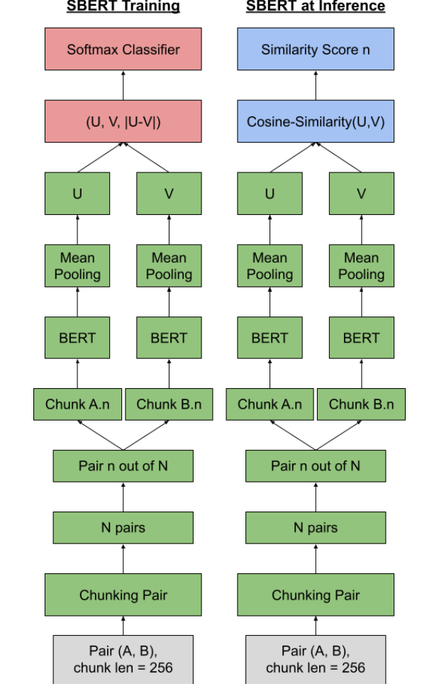

# Enhancing Authorship Verification using Sentence-Transformers

Code for our notebook paper at **PAN@CLEF 2023**, ranked **1st** in the Authorship Verification task
(overall score **0.623** on the official test set).

📄 [Paper (CEUR-WS Vol. 3497)](https://ceur-ws.org/Vol-3497/paper-216.pdf) ·
🏁 [PAN 2023 Authorship Verification](https://pan.webis.de/clef23/pan23-web/author-identification.html)

## Task

Given two texts, decide whether they were written by the same author. PAN 2023 poses the problem
**across discourse types (DTs)**. Every pair combines two different DTs, written (essays, emails) or
spoken (interviews, speech transcriptions), from about 100 native English speakers aged 18–22.

## Method



*Figure 1 of the paper: the Siamese model at training and at inference time.*

**Data augmentation.** PAN 2022 is the same cross-DT task on written discourse, so its training set is
added to PAN 2023's:

| | Problems | Unique texts | Authors | Discourse types |
|---|---:|---:|---:|---|
| PAN 2022 train | 12,264 | 1,046 | 56 | essays, emails, text messages, business memos |
| PAN 2023 train | 8,836 | 886 | 56 | essays, emails, interviews, speech transcriptions |
| **Combined** | **21,100** | **1,932** | **112** | all six |

**Author-disjoint split** (after Martinez-Galicia et al., 2022). No text in one split has an author from
the other. Because cutting by author leaves too few negatives, pairs are rebuilt inside each split:
- positives `P = A × A` and negatives `N = A × B`, where A and B group the texts by author
- pairs that share a DT are removed
- positives and negatives are sampled in equal numbers

| Split | Total | Positive | Unique texts | Authors |
|---|---:|---:|---:|---:|
| Train | 18,968 | 9,484 | 1,740 | 101 |
| Validation | 2,132 | 1,066 | 192 | 11 |

**Chunking.** Each document is cut into chunks of K = 256 tokens, the model's maximum sequence length.
Chunk *i* of one document is paired with chunk *i* of the other, so a pair of documents yields M chunk
pairs, where M is the chunk count of the longer document (the shorter one's chunks are reused).

**Model.** `all-MiniLM-L12-v2` is a Siamese Sentence-Transformer (BERT-like encoder, mean pooling). It
is fine-tuned on the chunk pairs with a contrastive loss.

**Evaluation and non-answers.** At inference:
1. Each chunk pair is scored by the cosine similarity of its embeddings.
2. The M scores are averaged and mapped from [-1, 1] to [0, 1].
3. Two thresholds turn the score into an answer:
   - below p1: a negative answer
   - above p2: a positive answer
   - between them: 0.5, so the problem is left unanswered

**Hyper-parameters** (selected on the validation set):

| Parameter | Value |
|---|---|
| Chunk length | 256 |
| Batch size | 32 |
| Distance metric | cosine |
| Loss | ContrastiveLoss |
| Epochs | 189 |
| Scheduler | warmuplinear, 0 warm-up steps |
| Learning rate | 2e-5 |
| eps | 1e-6 |
| Thresholds p1 / p2 | 0.45 / 0.54 |

## Results

**PAN 2023 validation set**

| Model | AUC | c@1 | F0.5u | F1 | Brier | Overall |
|---|:---:|:---:|:---:|:---:|:---:|:---:|
| **all-MiniLM-L12-v2** | **0.684** | **0.632** | **0.615** | **0.711** | **0.761** | **0.681** |
| nli-distilroberta-base-v2 | 0.572 | 0.509 | 0.553 | 0.667 | 0.692 | 0.598 |
| Stylometric model (Weerasinghe et al., 2021) | 0.505 | 0.512 | 0.433 | 0.343 | 0.521 | 0.463 |

**PAN 2023 test set (TIRA): 1st place**

| Submission | Model | AUC | c@1 | F0.5u | F1 | Brier | Overall |
|---|---|:---:|:---:|:---:|:---:|:---:|:---:|
| resolving-globe | all-MiniLM-L12-v2 | 0.616 | 0.572 | 0.562 | 0.617 | 0.746 | **0.623** |
| reduced-graph | all-MiniLM-L12-v2 | 0.616 | 0.572 | 0.562 | 0.617 | 0.746 | **0.623** |
| golden-ottoman | all-MiniLM-L12-v2 | 0.598 | 0.546 | 0.550 | 0.622 | 0.744 | 0.612 |

All three runs use the same trained model:
- **resolving-globe** uses the default thresholds.
- **reduced-graph** gives the same answers but takes p1 and p2 as input options.
- **golden-ottoman** applies *soft chunking*: a sentence is not split across two chunks unless it alone is
  longer than 256 tokens.

## Repository structure

```
src/av_sbert/
  data.py         PAN pairs/truth/answers I/O and the PAN 2022 + 2023 combination
  split.py        author-disjoint, cross-DT, balanced train/validation split
  chunking.py     256-token chunking, soft (sentence-preserving) chunking, chunk pairing
  model.py        contrastive fine-tuning and chunk-averaged verification
  scoring.py      p1/p2 thresholds and their grid search
  metrics.py      AUC, c@1, F0.5u, F1, Brier and overall (PAN definitions)
  stylometric.py  feature-vector-difference baseline
  cli.py          av-predict: pairs.jsonl -> answers.jsonl, as run on TIRA
scripts/   prepare_data.py · train.py · tune_thresholds.py · evaluate.py · train_stylometric.py
configs/   minilm_l12.yaml
docs/      results.md · assets/
tests/     unit tests
Dockerfile
```

## Usage

```bash
pip install -e ".[model,stylometric,dev]"

# 1. combine PAN 2022 + 2023 and build the author-disjoint split
python scripts/prepare_data.py --pan22 data/pan22-authorship-verification-training-dataset \
                               --pan23 data/pan23-authorship-verification-training-dataset \
                               --out data/prepared

# 2. fine-tune all-MiniLM-L12-v2
python scripts/train.py --config configs/minilm_l12.yaml

# 3. choose p1/p2 on validation
python scripts/tune_thresholds.py --model runs/all-MiniLM-L12-v2/best --pairs data/prepared/val.jsonl --save

# 4. predict (resolving-globe / reduced-graph / golden-ottoman)
av-predict -i <dataset-dir> -o <output-dir> --model runs/all-MiniLM-L12-v2/best
av-predict -i <dataset-dir> -o <output-dir> --model runs/all-MiniLM-L12-v2/best --p1 0.45 --p2 0.54
av-predict -i <dataset-dir> -o <output-dir> --model runs/all-MiniLM-L12-v2/best --soft

# 5. score against ground truth
python scripts/evaluate.py --truth data/prepared/val_pan/truth.jsonl --answers <output-dir>/answers.jsonl

# baselines
python scripts/train.py --config configs/minilm_l12.yaml --model sentence-transformers/nli-distilroberta-base-v2 \
                        --chunk-len 512 --output-dir runs/nli-distilroberta-base-v2
python scripts/train_stylometric.py --train data/prepared/train.jsonl --val data/prepared/val.jsonl

python -m pytest tests
```

The PAN datasets are distributed by the PAN organisers and are not included in this repository.

## Citation

```bibtex
@inproceedings{ibrahim2023enhancing,
  title     = {Enhancing Authorship Verification using Sentence-Transformers},
  author    = {Ibrahim, Momen and Akram, Ahmed and Radwan, Mohammed and Ayman, Rana and
               Abd-El-Hameed, Mustafa and El-Makky, Nagwa and Torki, Marwan},
  booktitle = {Working Notes of CLEF 2023 -- Conference and Labs of the Evaluation Forum},
  series    = {CEUR Workshop Proceedings},
  volume    = {3497},
  year      = {2023},
  url       = {https://ceur-ws.org/Vol-3497/paper-216.pdf}
}
```

## References

- N. Reimers, I. Gurevych. *Sentence-BERT: Sentence Embeddings using Siamese BERT-Networks.* 2019.
- J. A. Martinez-Galicia, D. Embarcadero-Ruiz, A. Ríos-Orduña, H. Gómez-Adorno. *Graph-based Siamese Network for Authorship Verification.* 2022.
- J. Weerasinghe, R. Singh, R. Greenstadt. *Feature Vector Difference based Authorship Verification for Open-World Settings.* CLEF 2021.
- E. Stamatatos et al. *Overview of the Authorship Verification Task at PAN 2023.* CLEF 2023.
- M. Fröbe et al. *Continuous Integration for Reproducible Shared Tasks with TIRA.io.* ECIR 2023.

## License

Code: MIT. The paper and its figure are © the authors, CC BY 4.0.
